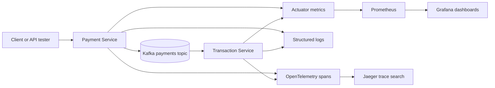
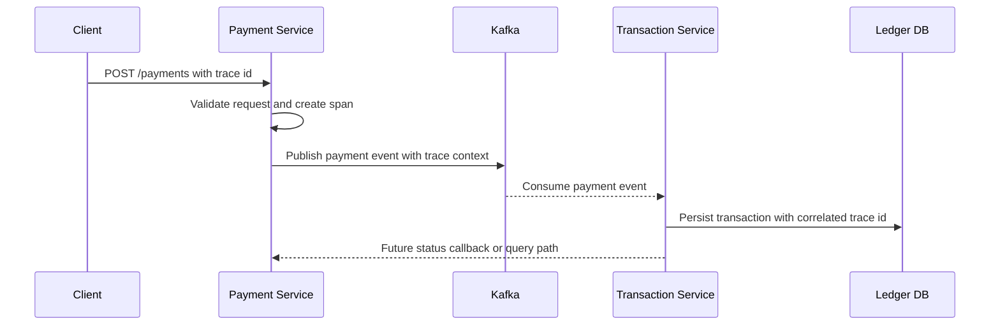

# Observability

FinBank treats observability as part of the service design, not an afterthought.
The goal is to make payment behavior, customer-facing latency, ledger outcomes,
and platform health easy to inspect from the first portfolio demo.

The design sections below describe the target operating model. Verified current
coverage is documented separately under [Current Runtime Export](#current-runtime-export)
and [Grafana Runtime Dashboard](#grafana-runtime-dashboard).

## Target Signal Ownership

| Signal | Owner | First useful view | Why it matters |
| --- | --- | --- | --- |
| HTTP latency | Every service | p95 latency by route and status | Shows customer impact and slow endpoints. |
| Payment state changes | Payment Service | Created, completed, failed, and retried payments | Makes the core business workflow visible. |
| Ledger writes | Transaction Service | Successful and failed transaction inserts | Confirms payment events become auditable entries. |
| Kafka consumer lag | Transaction Service | Lag by consumer group and topic | Detects delayed settlement or stuck consumers. |
| Database health | Platform | Connection pool usage and query errors | Catches saturation before requests fail. |
| Trace spans | All services | Cross-service payment timeline | Explains where a payment spent time. |

## Target Signal Flow

This diagram is the intended end state. It does not claim that the services
currently emit OpenTelemetry spans or that an external telemetry backend is
running.



## Target Dashboard Slices

These are desired dashboard slices, not a list of the panels in the checked-in
starter. The starter's verified twelve-panel coverage is described below and in
the [Grafana dashboard guide](grafana-dashboard.md#filters-and-panels).

| Dashboard | Panels |
| --- | --- |
| Service Health | Uptime, request rate, error rate, p95 latency, JVM memory, thread count |
| Payment Flow | Payment creation rate, status distribution, event publish failures, retry count |
| Ledger Flow | Kafka lag, transaction insert rate, ledger write failures, duplicate event count |
| Platform | MySQL availability, connection pool usage, container restarts, CPU and memory |

## Current Runtime Export

All three Spring Boot services now publish the framework's Prometheus-format
Actuator metrics at the following local endpoints:

| Service | Endpoint |
| --- | --- |
| Account Service | `http://localhost:8081/actuator/prometheus` |
| Payment Service | `http://localhost:8082/actuator/prometheus` |
| Transaction Service | `http://localhost:8083/actuator/prometheus` |

These endpoints expose framework and runtime signals, such as HTTP, JVM, and
process metrics. The payment and transaction services also publish three
business metrics without custom tags:

| Prometheus metric | Meaning |
| --- | --- |
| `finbank_payment_outbox_retries_total` | Automatic retries scheduled after failed publish attempts. Terminal exhaustion and operator recovery are excluded. |
| `finbank_transaction_duplicate_events_total` | Exact payment-event replays accepted without a second ledger entry. Conflicting duplicates are excluded. |
| `finbank_payment_outbox_stuck` | Non-exhausted `PENDING` outbox events created before the configured age cutoff. |

The stuck-event threshold defaults to 300000 ms and can be changed with
`PAYMENT_STUCK_AFTER_MS`. The gauge is an operational indicator, not proof of a
stuck customer payment or Kafka non-delivery. A repository read failure exports
`NaN`, and the dashboard maps null or `NaN` to **No data** instead of reporting
a false zero. The payment service allowlists this exact Prometheus endpoint, so
the local request does not require operator credentials.

Treat all three endpoints as operational surfaces and keep them behind trusted
network access. The account and transaction services do not add application
authentication, and the payment endpoint is deliberately anonymous.

Verify a running local service with:

```bash
curl --fail http://localhost:8081/actuator/prometheus
curl --fail http://localhost:8082/actuator/prometheus
curl --fail http://localhost:8083/actuator/prometheus
```

The legacy `/metrics` route remains unavailable (`404`). The held Kubernetes
Prometheus manifest still targets `/metrics`; its scrape path must be aligned
to `/actuator/prometheus` when platform work is released.

## Grafana Runtime Dashboard

The repository includes an importable, deployment-independent runtime overview
starter with twelve panels, `$service_group`, `$job`, and `$instance` filters,
verified framework metrics, and the three zero-tag business metrics above. Its
`$service_group` filter defaults to the existing
`microservices` scrape label so a shared datasource does not mix unrelated
targets into FinBank results. The `group` label key is a portability prerequisite;
a deployment with another key must adapt the JSON selectors. See the [Grafana dashboard guide](grafana-dashboard.md) for
the import steps, panel meanings, accessibility cues, and the difference
between zero and **No data**. Its HTTP duration panel shows a mean, not p95,
and it creates no alerts.

Because the held Kubernetes Prometheus manifest still scrapes `/metrics`, a
Kubernetes-backed import will show **DOWN** or **No data** until that scrape
path is released and aligned. No live dashboard screenshot is claimed.

## Alert Candidates

These are future design candidates. The repository does not create alert rules,
and some triggers require signals that are not part of the current export or
dashboard starter.

| Alert | Trigger | Severity |
| --- | --- | --- |
| Payment API error spike | 5xx rate above 2 percent for 10 minutes | High |
| Ledger consumer lag | Kafka lag grows for 15 minutes | High |
| Payment publish failure | Any sustained event publish failure | High |
| Database pool pressure | Pool usage above 85 percent for 10 minutes | Medium |
| Slow customer route | p95 latency above 750 ms for 15 minutes | Medium |

## Trace Roadmap

The sequence below is planned behavior; the services do not yet include tracing
instrumentation or context propagation.



The runtime export, bounded business metrics, and a deployment-independent
dashboard starter are available locally. The next observability work is to align
the held Kubernetes scrape configuration, verify it with a live dashboard
screenshot, then add tracing.
